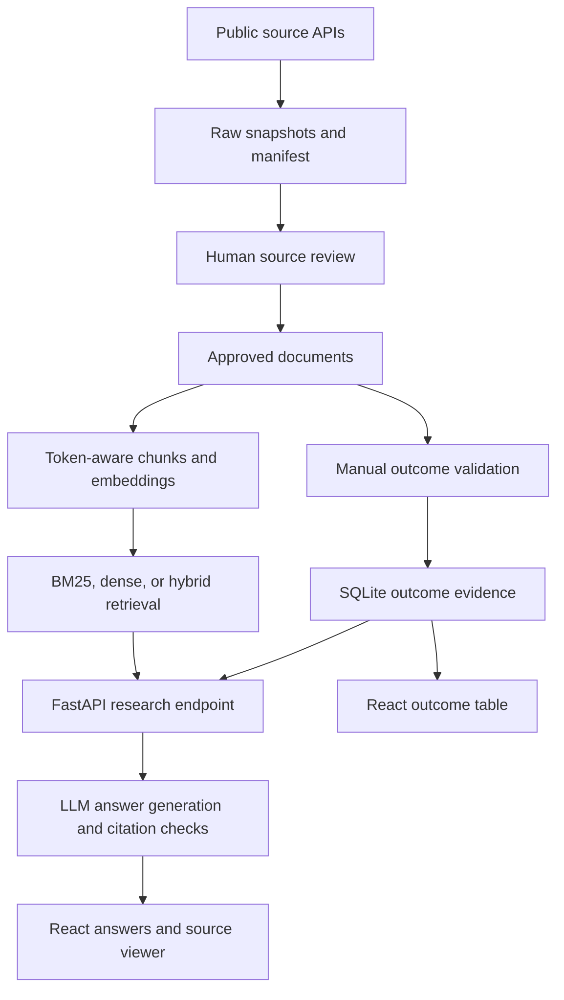

# PharmaScope AI
### Competitive intelligence, grounded in evidence.

**Turn scattered clinical-trial records, research abstracts, and drug labels into searchable evidence and source-linked answers.**

PharmaScope AI is a full-stack **Generative AI research assistant** that combines **hybrid retrieval, LLM-generated answers with citations, and manually validated trial outcomes** in a React application. It is built around a practical competitive-intelligence task: help an analyst investigate competing drugs while preserving the sources, dates, and trial context behind each finding.

**Generative AI · RAG · React · TypeScript · FastAPI · Sentence Transformers · BM25 · SQLite · Docker**

[Short implementation guide](BUILD_GUIDE_WITH_CODE.md)

> **Example research question**  
> “What outcomes were reported for semaglutide and dulaglutide in the indexed trials? Show the supporting evidence and explain what limits the comparison.”

**Status:** Working local research prototype. Live source ingestion and retrieval have been exercised; answer-quality benchmarking and production deployment remain work in progress.

## The business problem

Preparing a competitor briefing requires reconciling trial registrations, posted results, publications, and product labels. These sources answer different questions, may describe the same underlying trial, and may omit the details needed for a defensible comparison.

PharmaScope AI brings that evidence into one workflow:

1. **Find** relevant passages across approved source records.
2. **Inspect** the exact text, original URL, source date, and retrieval timestamp.
3. **Generate** a written answer from the retrieved evidence, with claim-level citations and explicit limitations.
4. **Compare** manually validated outcome rows while retaining population, arm, endpoint, units, and time point.

The intended outcome is a faster, more traceable research workflow. Analyst time savings have not yet been measured.

## What makes this project useful

| Capability | Implementation | Why it matters |
|---|---|---|
| **Three-source ingestion** | ClinicalTrials.gov, PubMed E-utilities, and openFDA label APIs | Brings registry, publication, and label evidence into a shared research workflow |
| **Source provenance** | Raw snapshots, content hashes, source identifiers, dates, and an ingestion manifest | Lets a reviewer trace indexed material back to its source version |
| **Hybrid retrieval** | BM25 and normalized dense embeddings combined with reciprocal rank fusion | Provides directly comparable keyword, semantic, and combined retrieval baselines |
| **Inspectable answers** | LLM-generated answers grounded in retrieved passages, with claim-level citations and schema validation | Makes supporting passages accessible alongside generated claims |
| **Structured numerical evidence** | Manually reviewed outcome rows in SQLite, linked to indexed passages | Preserves the context required to interpret trial measurements |
| **Evaluation tooling** | Recall@6, MRR@6, and paired group-level bootstrap comparisons | Supports experiments with explicit metrics rather than anecdotal demos |
| **Engineering integration** | React/TypeScript frontend, typed FastAPI requests, and Docker configuration | Connects the data pipeline to a usable application |

## Research scope

- **Indication:** Type 2 diabetes.
- **Drugs:** Semaglutide and dulaglutide.
- **Sources:** Selected ClinicalTrials.gov records, PubMed abstracts, and FDA label records through openFDA.
- **Starting evidence:** SUSTAIN 7 registry record **NCT02648204** and publication **PMID 29397376**, alongside bounded API search results.

Sources are downloaded programmatically, then reviewed before indexing. Search results are candidates, not an exhaustive or automatically validated evidence base. The registry and publication for one trial are treated as related sources, not independent clinical studies.

## Architecture



### Retrieve evidence and generate cited answers

- **BM25:** Keyword retrieval over filtered passages.
- **Dense:** Local Sentence Transformers embeddings ranked by cosine similarity through normalized vector dot products.
- **Hybrid:** Reciprocal rank fusion of keyword and dense rankings.
- **Filters:** Drug and source type.
- **Generation:** The LLM combines retrieved evidence into a written answer with citations, using a configured chat-completions-compatible provider endpoint.
- **Validation:** Pydantic checks the output schema; the backend rejects unknown citation identifiers and contradictory insufficient-evidence output.

The primary user workflow is **retrieval-augmented generation (RAG)**: ask a question, retrieve relevant evidence, and generate a cited answer. Retrieval supplies the evidence; the LLM writes the response. Indexing documents does not retrain the language model.

Cited answer generation is enabled by default. Retrieval-only mode remains available for debugging and retrieval experiments.

### Structured evidence

Curated rows retain trial ID, drug, arm, population, endpoint, time point, value, units, measurement type, and a supporting passage ID. The importer requires an explicit validation flag and an existing indexed passage.

The research endpoint can include up to 12 curated rows matching its drug/source filters, together with their supporting passages. Set `use_curated: false` for a document-only comparison. Row selection is currently bounded and filter-based; question-specific selection and automatic numerical claim verification are planned improvements.

## Example questions

- What populations, comparators, and primary endpoints appear in the indexed trials?
- Which indexed records contain posted results rather than protocol descriptions alone?
- What reported outcomes can be traced to the selected trial passages?
- What indications or warnings appear in the selected label records?
- What information is missing for the comparison requested?

These are intended research tasks, not claims of benchmarked answer accuracy. Answers depend on the approved corpus and the configured generation model.

## 📁 Project Directory Structure

```text
pharmascope-ai/
├── frontend/
│   ├── src/
│   │   ├── main.tsx                  # Research interface, filters, and evidence viewer
│   │   └── style.css                 # Application styling
│   ├── index.html                    # Frontend entry page
│   ├── package.json                  # Frontend dependencies and scripts
│   ├── package-lock.json             # Locked dependency versions
│   ├── tsconfig.json                 # TypeScript configuration
│   ├── nginx.conf                    # Frontend web-server configuration
│   └── Dockerfile                    # Frontend container build
├── backend/
│   ├── app/
│   │   ├── __init__.py               # Python package initialization
│   │   ├── main.py                   # API endpoints and cited-answer generation
│   │   ├── core.py                   # Chunking, indexing, retrieval, and evidence storage
│   │   └── ingest.py                 # Source downloads and document approval
│   ├── requirements.txt              # Backend dependencies
│   └── Dockerfile                    # Backend container build
├── data/
│   ├── raw/                          # Original source snapshots and manifests
│   ├── processed/                    # Approved and normalized documents
│   ├── index/                        # Searchable passages and embeddings
│   ├── curated/                      # Reviewed outcomes and source-selection notes
│   └── evidence.db                   # Generated SQLite evidence database
├── evaluation/
│   ├── evaluate.py                   # Retrieval metrics and statistical comparisons
│   ├── question_template.json        # Benchmark annotation template
│   └── answer_review_template.csv    # Answer-quality review template
├── tests/
│   └── test_pipeline.py              # Pipeline and API validation checks
├── .env.example                      # Environment-variable template
├── .gitignore                        # Git exclusions
├── .dockerignore                     # Docker build exclusions
├── compose.yaml                      # Local container configuration
├── BUILD_GUIDE_WITH_CODE.md           # Setup and implementation guide
├── VERIFICATION.md                    # Verification record and testing boundaries
└── README.md                         # Project overview
```


## Data sources

- [ClinicalTrials.gov API](https://clinicaltrials.gov/data-api/api)
- [PubMed E-utilities](https://www.ncbi.nlm.nih.gov/books/NBK25499/)
- [openFDA drug labels](https://open.fda.gov/apis/drug/label/how-to-use-the-endpoint/)
- [SUSTAIN 7 registry record](https://clinicaltrials.gov/study/NCT02648204)
- [SUSTAIN 7 publication](https://pubmed.ncbi.nlm.nih.gov/29397376/)
- [NCBI disclaimer and copyright](https://www.ncbi.nlm.nih.gov/About/disclaimer.html)
